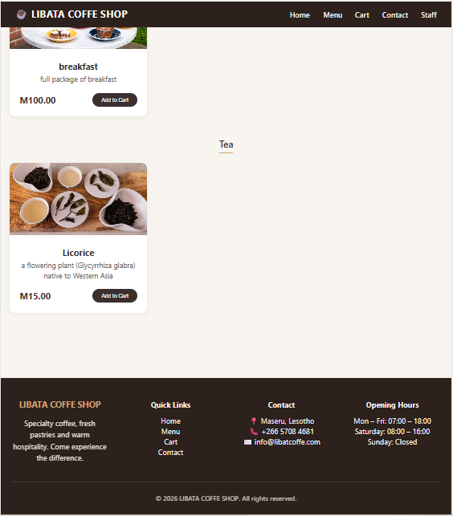
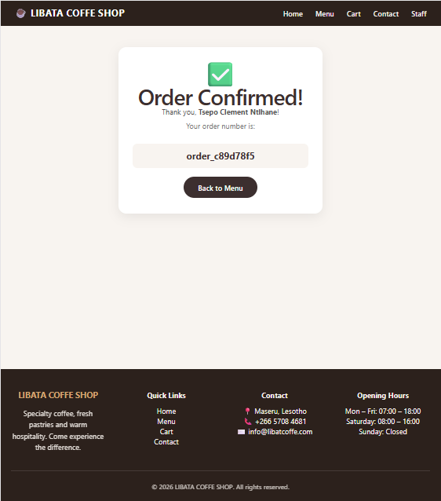
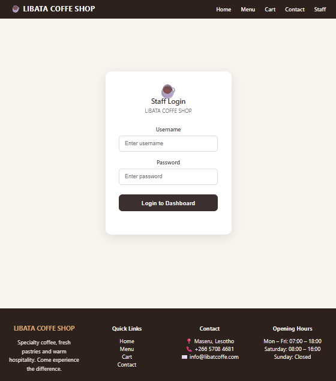
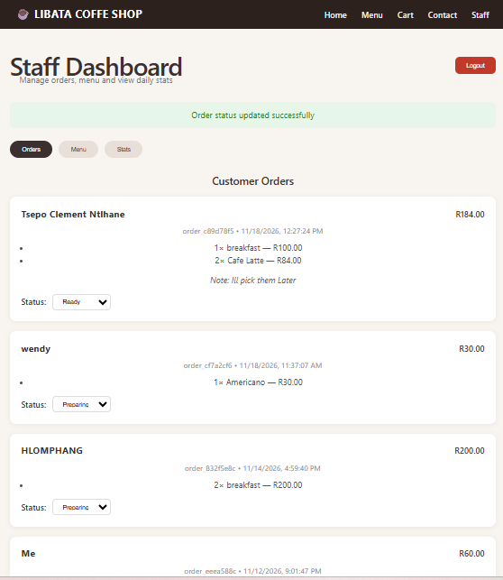
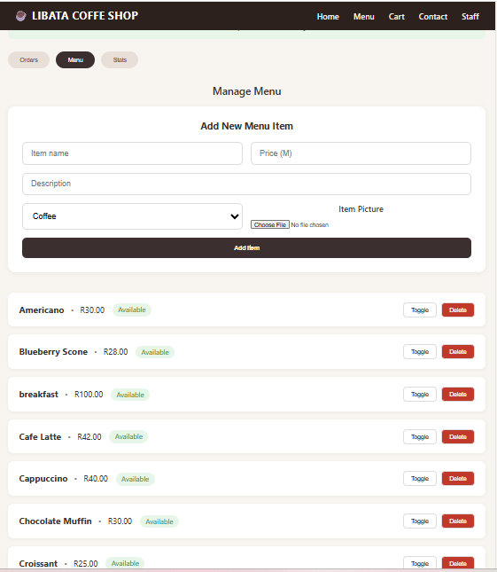
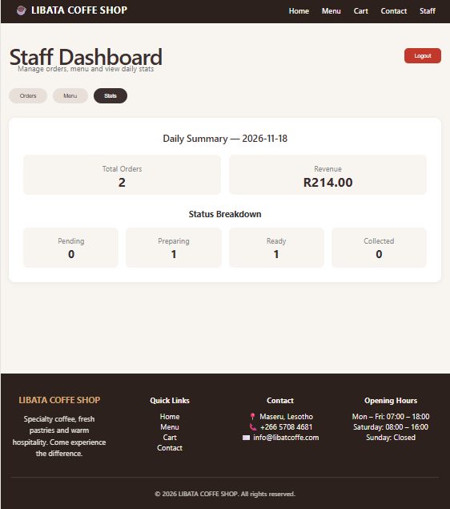

# LIBATA COFFE SHOP - Coffee Shop Management System

A full-stack web application developed for managing a local coffee shop.  
Customers can browse the menu, add items to a cart, and place orders.  
Staff can manage menu items, process orders, and view daily summaries.

**GitHub Repository:** [https://github.com/tsepontlhane15/coffee-shop-system](https://github.com/tsepontlhane15/coffee-shop-system)

---

## Technologies Used

### Frontend
- React (Vite)
- React Router DOM
- Fetch API
- Context API (Cart state management)
- Hosted on Vercel / Netlify

### Backend
- Node.js + Express.js
- Redis (Key-Value NoSQL Database)
- JWT Authentication
- Hosted on Render

### Tools
- Git & GitHub
- dotenv

---

## Features

### Customer Features
- View menu items (Coffee, Tea, Pastries, Other)
- See item name, description, price and availability
- Add items to cart and update quantities
- Place an order with customer name and optional notes
- Receive order confirmation with unique order number

### Staff Features
- Secure staff login
- Add, update and delete menu items
- Upload pictures for menu items
- View all customer orders
- Update order status (Pending → Preparing → Ready → Collected)
- View daily order statistics and revenue

---

## Screenshots

### Menu Page


### Menu Page (Continued)


### Order Confirmation


### Staff Login


### Staff Dashboard - Orders


### Staff Dashboard - Menu Management


### Staff Dashboard - Daily Stats


---

## API Endpoints

| Method | Endpoint                  | Access  | Description                  |
|--------|---------------------------|---------|------------------------------|
| GET    | `/api/health`             | Public  | Health check                 |
| POST   | `/api/auth/login`         | Public  | Staff login                  |
| GET    | `/api/menu`               | Public  | Get all menu items           |
| GET    | `/api/menu/:id`           | Public  | Get one menu item            |
| POST   | `/api/menu`               | Staff   | Add menu item                |
| PUT    | `/api/menu/:id`           | Staff   | Update menu item             |
| DELETE | `/api/menu/:id`           | Staff   | Delete menu item             |
| GET    | `/api/orders`             | Staff   | Get all orders               |
| GET    | `/api/orders/stats/daily` | Staff   | Daily summary                |
| GET    | `/api/orders/:id`         | Public  | Get specific order           |
| POST   | `/api/orders`             | Public  | Place an order               |
| PATCH  | `/api/orders/:id/status`  | Staff   | Update order status          |

---

## Installation & Setup

### Prerequisites
- Node.js (v18+)
- Redis
- Git

### Backend Setup
```bash
cd coffee-shop-backend
npm install
```

Create a `.env` file:
```env
PORT=5000
REDIS_URL=redis://localhost:6379
JWT_SECRET=your_secret_key
JWT_EXPIRES_IN=24h
STAFF_USERNAME=staff
STAFF_PASSWORD=staff123
```

Start the server:
```bash
npm run dev
```

### Frontend Setup
```bash
cd coffee-shop-frontend
npm install
npm run dev
```

The frontend will run at: `http://localhost:5173`

---

## Default Staff Login
- **Username:** `staff`
- **Password:** `staff123`

---

## Deployment

- **Backend:** Render
- **Frontend:** Vercel or Netlify
- **Database:** Redis (Upstash or Redis Cloud recommended)

---

## Group Members & Contributions

| #  | Member Name              | Contribution                                      |
|----|--------------------------|---------------------------------------------------|
| 1  | Tsepo Ntlhane            | Project coordination, Backend API, Authentication |
| 2  | Member 2                 | Frontend UI design, Home page, Menu page          |
| 3  | Member 3                 | Shopping Cart functionality, Order placement      |
| 4  | Member 4                 | Staff Dashboard, Order management                 |
| 5  | Member 5                 | Menu management (Add/Edit/Delete items)           |
| 6  | Member 6                 | Database integration (Redis), Seed data           |
| 7  | Member 7                 | Testing, Documentation, README, Deployment        |

> **Note:** Replace "Member 2" to "Member 7" with the real names of your group members.

---

## How to Run Locally

1. Start Redis
2. Start Backend → `cd coffee-shop-backend` then `npm run dev`
3. Start Frontend → `cd coffee-shop-frontend` then `npm run dev`
4. Open `http://localhost:5173` in your browser

---

## License

This project was developed as a group assignment for **BIWA2110 – Web Application Development**.
